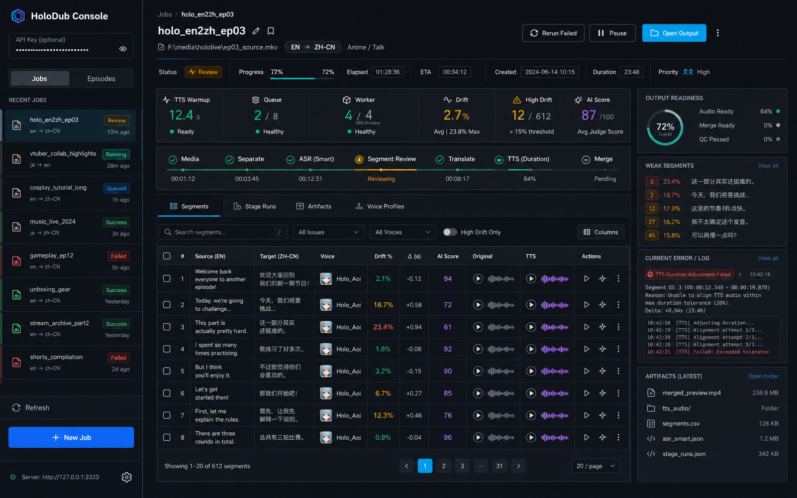
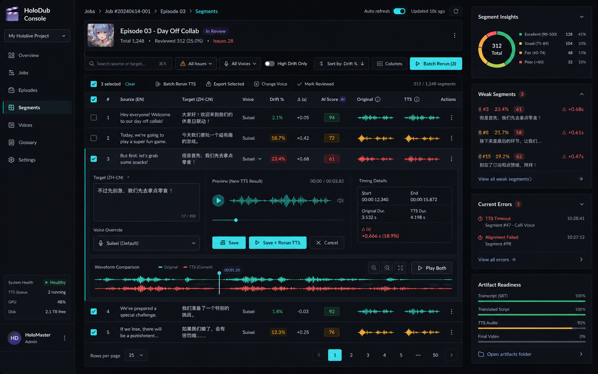
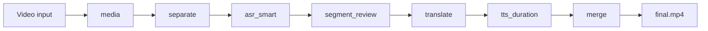
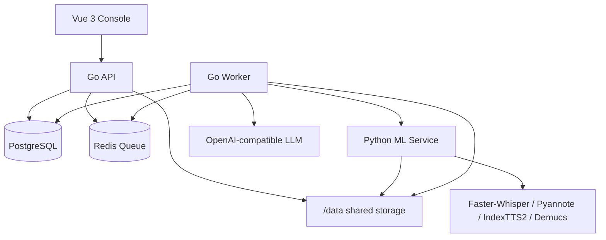

# HoloDub

<div align="center">

  

  <h3>Self-hosted AI video dubbing that keeps the performance in sync.</h3>

  <p>
    Timeline-first dubbing · Smart ASR segmentation · Duration-aware TTS · Voice cloning · Operator-grade observability
  </p>

  <p>
    <a href="https://golang.org/">
      
    </a>
    <a href="https://www.python.org/">
      
    </a>
    <a href="#">
      
    </a>
    <a href="#">
      
    </a>
    <a href="https://www.apache.org/licenses/LICENSE-2.0">
      
    </a>
  </p>

  <p>
    <a href="README_zh-CN.md">中文文档</a>
    ·
    <a href="docs/README.md">Documentation map</a>
    ·
    <a href="docs/openapi.yaml">OpenAPI</a>
  </p>

</div>

> Dub the whole performance, not just the words.

HoloDub is a local-first dubbing studio for creators, educators, media teams, and small studios who want to translate videos without giving up control of their footage, voices, prompts, or GPU budget.

It does more than produce translated subtitles. HoloDub rebuilds the audio track around the original timeline: it detects semantic boundaries, translates with duration pressure, synthesizes speaker-specific voices, measures timing drift, and gives operators a console to inspect every segment before the final video is merged.

## Why It Exists

Most AI dubbing pipelines break in the details:

- Subtitles translate, but speech no longer fits the scene.
- A beautiful TTS voice drifts half a second late.
- Long videos fail after hours and leave no clue where.
- One bad ASR segment forces the whole job to be rerun.
- SaaS tools are convenient, but not always acceptable for private media or custom models.

HoloDub is built for the other path: your models, your machine, your data, your final cut.

## What It Can Do Today

- Run an end-to-end video dubbing pipeline with Docker Compose.
- Split speech into meaning-aware segments using Faster-Whisper timestamps and VAD signals.
- Translate through OpenAI-compatible providers such as DeepSeek, Qwen-compatible endpoints, or your own gateway.
- Synthesize duration-aware speech with IndexTTS2, including zero-shot voice cloning from short reference clips.
- Retry only the failing or high-drift pieces instead of rerunning a whole video.
- Review ASR boundaries, merge/split segments, adjust timestamps, edit transcripts, and re-run a single segment.
- Track model warmup, job stages, artifacts, drift, judge scores, weak segments, and current errors in the web console.
- Expose Prometheus metrics and production deployment building blocks.

## Interface Direction

The web UI has been redesigned as an observability-first dubbing console. Jobs are not black boxes: every stage, segment, artifact, and timing issue becomes inspectable.



The segment workbench is built for real operator work: filter high drift, compare original audio with TTS, inspect waveforms, edit translations, change voice profiles, and rerun only the rows that need attention.



The implementation follows this design system in Vue 3 + Tailwind. The screenshots above are design figures used to guide the current UI refresh; live data appears once the Go API and worker are running.

## Public Production Showcase

HoloDub has moved beyond a one-off demo and powered a continuous, publicly released English-to-Chinese lecture series:

- Series: MIT 6.824 Distributed Systems, Lectures 1-7.
- Published output: 7 full-length episodes, 561.7 minutes (9.36 hours) in total.
- Watch the series on Bilibili: [MIT 6.824 English-to-Chinese series powered by HoloDub](https://www.bilibili.com/video/BV1uYXFBLEPo/).

This series demonstrates repeatable production across multiple long-form episodes. It is a self-produced public showcase, not a customer engagement or paid commercial case. The figures above describe released output only; they do not represent audience traction or third-party quality certification.

## Representative Benchmark

A representative full-length lecture remains the controlled technical benchmark for the pipeline:

- Source: English lecture video, 79 minutes, 626 segments.
- Pipeline: Faster-Whisper large-v3 -> Qwen-compatible translation -> IndexTTS2 FP16.
- Hardware: RTX 5080, Docker + WSL2.
- Result: full English-to-Chinese dubbed output, roughly one hour end to end after model warmup.
- Timing: average segment drift under 1 percent in the validated run; outliers are surfaced for retranslation and manual review.

For a shorter introduction, watch the earlier 10-minute [HoloDub quick demo on Bilibili](https://www.bilibili.com/video/BV1vrwszEELd/).

## Core Pipeline



Each stage is explicit and observable:

| Stage            | What happens                                                                |
| ---------------- | --------------------------------------------------------------------------- |
| `media`          | Normalize and prepare the source media.                                     |
| `separate`       | Optional vocal/BGM separation.                                              |
| `asr_smart`      | Generate word-level ASR and semantic speech segments.                       |
| `segment_review` | Let an LLM propose safe boundary fixes; optionally require human approval.  |
| `translate`      | Produce dubbing-friendly translations with duration pressure.               |
| `tts_duration`   | Synthesize each segment with target duration and voice profile constraints. |
| `merge`          | Rebuild the final video with aligned dubbed audio.                          |

## Architecture



HoloDub is intentionally single-node friendly:

- Go control plane: Gin, GORM, worker orchestration, queues, API, embedded UI.
- Python data plane: FastAPI, PyTorch, ASR, VAD, separation, TTS, model registry, GPU concurrency control.
- Storage: PostgreSQL metadata + Redis queue + `/data` for media, audio, artifacts, and model references.
- UI: Vue 3, Vite, Tailwind CSS, WaveSurfer.js, lucide icons.
- Observability: structured logs, Prometheus metrics, Grafana dashboard, readiness probes, warmup state.

## Quick Start

### 1. Smoke mode: no GPU, no API key

```powershell
Copy-Item .env.example .env
docker compose up --build -d
```

Submit a test job:

```powershell
$body = '{"input_relpath":"input-smoke.mp4","target_language":"zh","auto_start":true}'
Invoke-RestMethod -Uri "http://127.0.0.1:8080/jobs" -Method POST -ContentType "application/json" -Body $body
```

Open the console:

```text
http://localhost:8080/ui/
```

Smoke mode uses mock translation, mock ASR, and silence/placeholder TTS so you can verify orchestration before downloading large models.

### 2. Real translation

Set an OpenAI-compatible provider in `.env`:

```env
TRANSLATION_PROVIDER=openai_compatible
OPENAI_BASE_URL=https://api.deepseek.com/v1
OPENAI_API_KEY=sk-xxxxxx
OPENAI_MODEL=deepseek-chat
```

Any compatible endpoint can be used as long as it follows the OpenAI chat API shape.

### 3. Real ASR + IndexTTS2

For GPU-backed runs:

```env
ML_PYTHON_EXTRAS=real
ML_ASR_BACKEND=faster_whisper
FASTER_WHISPER_MODEL=large-v3

ML_TTS_BACKEND=indextts2
INDEXTTS2_INLINE=true
INDEXTTS2_USE_EMO_TEXT=true
```

Build and start:

```powershell
docker compose build ml-service
docker compose --env-file .env up -d
```

Always pass `--env-file .env` when you run the stack. It prevents accidental fallback to `.env.example` when a shell-level `COMPOSE_ENV_FILE` is set.

For the full environment matrix, see the [configuration reference](docs/configuration.md).

## IndexTTS2 In HoloDub

IndexTTS2 is the primary TTS backend because dubbing needs more than a nice voice. It needs timing.

HoloDub uses IndexTTS2 with:

- Zero-shot voice cloning from short reference audio.
- Per-speaker voice profile mapping.
- Duration ceilings derived from translated text and available silence gap.
- Drift-based retranslation when speech would overlap the next segment.
- Background warmup and readiness reporting, so the first real TTS request does not silently block the operator.
- Optional BigVGAN CUDA precompile path for Blackwell/RTX 50-series systems.

Example voice profile:

```powershell
$body = @{
    name = "Host Voice"
    mode = "sample"
    language = "zh"
    sample_relpaths = @("voices/host_ref.wav")
} | ConvertTo-Json

Invoke-RestMethod `
  -Uri "http://localhost:8080/voice-profiles" `
  -Method Post `
  -ContentType "application/json" `
  -Body $body
```

Bind a speaker in a job:

```powershell
$body = @{
  bindings = @(@{ speaker_label = "SPK_01"; voice_profile_id = <profile_id> })
} | ConvertTo-Json

Invoke-RestMethod `
  -Uri "http://localhost:8080/jobs/<job_id>/bindings" `
  -Method Put `
  -ContentType "application/json" `
  -Body $body
```

## Operator Console

The console is built around the work that actually happens after the model output arrives.

Read the [UI usage guide](docs/ui-guide.md) for the full operator workflow.

| Surface                  | What it gives you                                                                                 |
| ------------------------ | ------------------------------------------------------------------------------------------------- |
| Job rail                 | Recent jobs and episodes with health/status summaries.                                            |
| Language switcher        | Toggle the console between Chinese and English, persisted locally in the browser.                 |
| Job observability header | Current stage, segment count, high-drift count, output readiness, AI score, runtime.              |
| Stage timeline           | At-a-glance pipeline progress and failed stages.                                                  |
| Segment table            | Source text, target text, voice, drift, delta seconds, judge score, audio, row actions.           |
| Segment review           | LLM suggestions, manual merge/split, transcript edits, timestamp edits, single-segment ASR retry. |
| Artifact panel           | Final video, intermediate audio, CSV/JSON traces, and latest outputs.                             |

## Deployment Notes

The project ships with:

- Docker Compose for local and server runs.
- `docker-compose.staging.yml` and `docker-compose.prod.yml` overlays.
- Helm chart skeleton under `deploy/helm/holodub`.
- Release and rollout notes under `docs/production`.
- Prometheus scrape config, rules, and Grafana dashboard under `docs/observability`.
- OpenAPI specification at `docs/openapi.yaml`.

For a headless Linux GPU server, the high-level path is:

```bash
git clone https://github.com/YuehaoDai/HoloDub.git
cd HoloDub
cp .env.example .env
docker compose build ml-service
docker compose -f docker-compose.yml -f docker-compose.staging.yml --env-file .env up -d
```

## Project Status

HoloDub is already capable of real end-to-end dubbing, and the current engineering focus is reliability, controllability, and repeatable long-form quality.

Completed highlights:

- Go API and worker pipeline.
- Python ML service with real ASR and IndexTTS2 integration.
- Duration-aware translation and retranslation loop.
- Segment review workflow with human-in-the-loop controls.
- Per-segment TTS persistence and retry.
- Batched ffmpeg merge for long videos.
- Web console redesign with observability-first UI.
- Prometheus/Grafana observability assets.
- CI/security hardening configuration.

Active areas:

- Production-grade vocal/BGM separation defaults.
- Pyannote diarization setup polish.
- Chinese reference-audio guidance for better prosody.
- More automated quality gates for chapter/episode-level judging.
- Shareable operator reports for long-running jobs.

## Documentation

Start here:

- [Documentation map](docs/README.md)
- [UI usage guide](docs/ui-guide.md)
- [Configuration reference](docs/configuration.md)
- [Observability setup](docs/observability/README.md)
- [Production release runbook](docs/production/release-runbook.md)
- [Scale roadmap](docs/production/scale-roadmap.md)
- [OpenAPI spec](docs/openapi.yaml)
- [Optimization roadmap](docs/roadmap/optimization-roadmap.md)

## Tech Stack

- Control plane: Go, Gin, GORM, Redis, PostgreSQL.
- ML service: Python, FastAPI, PyTorch, Faster-Whisper, Pyannote, Demucs/UVR5, IndexTTS2.
- Frontend: Vue 3, Vite, Tailwind CSS, WaveSurfer.js.
- Orchestration: Docker Compose, Helm skeleton.
- LLM providers: OpenAI-compatible APIs such as DeepSeek, Qwen-compatible gateways, or self-hosted endpoints.

## License

Apache 2.0.
