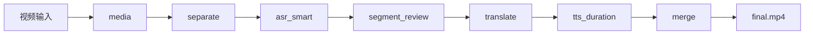
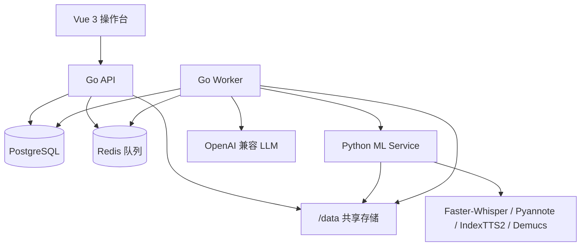

# HoloDub（幻读）

<div align="center">

  

  <h3>自托管 AI 视频配音系统，让翻译后的声音依然贴着原片节奏走。</h3>

  <p>
    时间轴优先 · 智能 ASR 切分 · 时长感知 TTS · 零样本声纹克隆 · 可观测操作台
  </p>

  <p>
    <a href="https://golang.org/">
      
    </a>
    <a href="https://www.python.org/">
      
    </a>
    <a href="#">
      
    </a>
    <a href="#">
      
    </a>
    <a href="https://www.apache.org/licenses/LICENSE-2.0">
      
    </a>
  </p>

  <p>
    <a href="README.md">English README</a>
    ·
    <a href="docs/README.md">文档导航</a>
    ·
    <a href="docs/openapi.yaml">OpenAPI</a>
  </p>

</div>

> 不只是翻译台词，而是重新配出整场表演。

HoloDub 是一个面向创作者、字幕组、教育内容团队和小型工作室的本地优先配音系统。它让你在自己的 GPU、自己的模型、自己的数据目录里完成长视频译制，而不是把素材、声音和工作流交给一个黑盒 SaaS。

它不满足于“翻译字幕 + 套一条 AI 声音”。HoloDub 围绕原视频时间轴重构音轨：先识别语义边界，再做时长受控翻译，用指定音色合成每段语音，测量漂移，暴露弱段，最后把可检查、可重跑、可追踪的结果合成回视频。

## 为什么需要 HoloDub

真实配音流水线里，最麻烦的往往不是“能不能生成声音”，而是这些细节：

- 字幕翻译出来了，但配音塞不回原画面。
- TTS 声音很好听，却总是慢半拍或快半拍。
- 长视频跑到一半失败，却不知道卡在哪个阶段、哪一段。
- 一个 ASR 错字或边界错误，不应该重跑整条视频。
- 私有素材、商业内容、定制音色，不一定适合上传到第三方平台。

HoloDub 选择另一条路：你控制模型，你控制数据，你控制最终声音。

## 当前已经能做什么

- 用 Docker Compose 跑通端到端视频配音流水线。
- 通过 Faster-Whisper 词级时间戳和 VAD 信号，生成语义更自然的切分段落。
- 接入 OpenAI 兼容翻译接口，例如 DeepSeek、Qwen 兼容网关或自建服务。
- 使用 IndexTTS2 进行时长感知 TTS，并支持短参考音频的零样本声纹克隆。
- 只重跑失败段、高漂移段或被人工修改过的段，而不是重跑整个视频。
- 在 UI 里审核 ASR 边界、合并/拆分片段、调整时间、编辑原文、重识别单段。
- 在操作台查看模型预热、阶段进度、输出文件、漂移率、AI 评分、弱段和当前错误。
- 暴露 Prometheus 指标，并提供 Grafana、OpenAPI、发布和部署文档骨架。

## 操作台设计

HoloDub 的 UI 已按“可观测配音工作台”重构。任务不再是一个黑盒：每个阶段、每个片段、每个输出文件和每个时间漂移都应该能被看见。


段落工作台服务于真正的精修工作：筛选高漂移段、对比原声与 TTS、查看波形、编辑译文、切换音色、只重跑有问题的行。


上面的图是本次 UI 改造使用的设计图例，当前 Vue 3 + Tailwind 实现已经沿用这套视觉系统。接入 Go API 和 Worker 后，界面会展示真实任务数据。

## 公开生产案例

HoloDub 已经从单次 Demo 走向连续公开生产，支撑完成 MIT 6.824 分布式系统课程英译中系列：

- 系列范围：Lecture 1-7。
- 公开成片：7 集，共 561.7 分钟（9.36 小时）。
- B 站观看：[HoloDub 支撑制作的 MIT 6.824 英译中系列](https://www.bilibili.com/video/BV1uYXFBLEPo/)。

该系列用于证明多集长视频的连续、可重复生产能力。这是团队自行制作并公开发布的作品案例，不是客户项目或付费商业案例；以上数字只描述公开成片数量与时长，不代表播放表现或第三方质量认证。

## 代表性技术基准

其中一条完整长视频作为受控条件下的代表性技术基准：

- 输入：英语讲座视频，79 分钟，626 个段落。
- 流水线：Faster-Whisper large-v3 -> Qwen 兼容翻译 -> IndexTTS2 FP16。
- 硬件：RTX 5080，Docker + WSL2。
- 结果：完整英语到中文配音视频，模型预热后端到端约一小时。
- 时长：验证运行中平均段落漂移低于 1%；异常段会进入再翻译或人工审查视图。

希望快速了解效果，可观看早期 10 分钟版 [HoloDub B 站快速演示](https://www.bilibili.com/video/BV1vrwszEELd/)。

## 核心流水线



每个阶段都是显式的、可追踪的：

| 阶段             | 做什么                                        |
| ---------------- | --------------------------------------------- |
| `media`          | 归一化并准备源媒体。                          |
| `separate`       | 可选的人声/BGM 分离。                         |
| `asr_smart`      | 生成词级 ASR 和语义语音片段。                 |
| `segment_review` | 让 LLM 提出安全的边界修正建议，可选人工确认。 |
| `translate`      | 生成适合配音、受时长约束的译文。              |
| `tts_duration`   | 按目标时长和音色约束合成每个片段。            |
| `merge`          | 把对齐后的配音重组回最终视频。                |

## 架构



HoloDub 默认适合单机部署：

- Go 控制面：Gin、GORM、Worker 编排、队列、API、嵌入式 UI。
- Python 数据面：FastAPI、PyTorch、ASR、VAD、分离、TTS、模型注册表、GPU 并发控制。
- 存储：PostgreSQL 元数据 + Redis 队列 + `/data` 媒体和产物目录。
- 前端：Vue 3、Vite、Tailwind CSS、WaveSurfer.js、lucide 图标。
- 可观测性：结构化日志、Prometheus 指标、Grafana dashboard、readyz、模型预热状态。

## 快速开始

### 1. 烟测模式：无需 GPU，无需 API key

```powershell
Copy-Item .env.example .env
docker compose up --build -d
```

提交测试任务：

```powershell
$body = '{"input_relpath":"input-smoke.mp4","target_language":"zh","auto_start":true}'
Invoke-RestMethod -Uri "http://127.0.0.1:8080/jobs" -Method POST -ContentType "application/json" -Body $body
```

打开操作台：

```text
http://localhost:8080/ui/
```

烟测模式使用 mock 翻译、mock ASR 和占位 TTS，适合先验证编排、队列、数据库和 UI。

### 2. 接入真实翻译

在 `.env` 中配置 OpenAI 兼容接口：

```env
TRANSLATION_PROVIDER=openai_compatible
OPENAI_BASE_URL=https://api.deepseek.com/v1
OPENAI_API_KEY=sk-xxxxxx
OPENAI_MODEL=deepseek-chat
```

只要接口形状兼容 OpenAI Chat API，就可以接入你自己的网关或模型服务。

### 3. 真实 ASR + IndexTTS2

GPU 推理配置：

```env
ML_PYTHON_EXTRAS=real
ML_ASR_BACKEND=faster_whisper
FASTER_WHISPER_MODEL=large-v3

ML_TTS_BACKEND=indextts2
INDEXTTS2_INLINE=true
INDEXTTS2_USE_EMO_TEXT=true
```

构建并启动：

```powershell
docker compose build ml-service
docker compose --env-file .env up -d
```

建议每次启动都显式传入 `--env-file .env`，避免 shell 中的 `COMPOSE_ENV_FILE` 误指向 `.env.example`。

完整环境变量矩阵见 [配置参考](docs/configuration.md)。

## HoloDub 如何使用 IndexTTS2

IndexTTS2 是 HoloDub 的主力 TTS 后端，因为配音不只需要好听的声音，更需要“能卡进时间轴”的声音。

HoloDub 使用 IndexTTS2 实现：

- 短参考音频零样本声纹克隆。
- 每个说话人绑定独立 Voice Profile。
- 根据译文字数和下一段前静音 gap 计算时长上限。
- 当合成语音会覆盖下一段时，触发漂移驱动再翻译。
- 启动时后台预热模型，并把 warmup 状态暴露到 UI 和 readyz。
- 针对 Blackwell/RTX 50 系列提供 BigVGAN CUDA 预编译路径。

创建一个音色档案：

```powershell
$body = @{
    name = "主持人音色"
    mode = "sample"
    language = "zh"
    sample_relpaths = @("voices/host_ref.wav")
} | ConvertTo-Json

Invoke-RestMethod `
  -Uri "http://localhost:8080/voice-profiles" `
  -Method Post `
  -ContentType "application/json" `
  -Body $body
```

绑定到任务中的说话人：

```powershell
$body = @{
  bindings = @(@{ speaker_label = "SPK_01"; voice_profile_id = <profile_id> })
} | ConvertTo-Json

Invoke-RestMethod `
  -Uri "http://localhost:8080/jobs/<job_id>/bindings" `
  -Method Put `
  -ContentType "application/json" `
  -Body $body
```

## 操作台能力

HoloDub 的前端不是装饰，它是长视频译制的控制台。

完整操作流程见 [UI 使用指南](docs/ui-guide.md)。

| 界面         | 能看到什么                                                   |
| ------------ | ------------------------------------------------------------ |
| 任务侧栏     | 最近 Jobs 和 Episodes，附带健康与状态摘要。                  |
| 语言切换     | 控制台可在中文和英文之间切换，并在浏览器本地记住偏好。       |
| 任务观测头部 | 当前阶段、段落数、高漂移数、输出就绪度、AI 评分、运行时长。  |
| 阶段时间线   | 一眼看到流水线进度和失败阶段。                               |
| 段落表格     | 原文、译文、音色、漂移率、偏差秒数、AI 评分、音频和行操作。  |
| 分段审查     | LLM 建议、手动合并/拆分、原文编辑、时间调整、单段 ASR 重试。 |
| 产物面板     | 最终视频、中间音频、CSV/JSON trace 和最新输出文件。          |

## 部署说明

项目已经包含：

- 本地和服务器运行用 Docker Compose。
- `docker-compose.staging.yml` 与 `docker-compose.prod.yml`。
- `deploy/helm/holodub` 下的 Helm chart 骨架。
- `docs/production` 下的发布、扩容和真实后端 rollout 文档。
- `docs/observability` 下的 Prometheus 抓取配置、告警规则和 Grafana dashboard。
- `docs/openapi.yaml` API 规范。

Linux GPU 服务器的最短路径：

```bash
git clone https://github.com/YuehaoDai/HoloDub.git
cd HoloDub
cp .env.example .env
docker compose build ml-service
docker compose -f docker-compose.yml -f docker-compose.staging.yml --env-file .env up -d
```

## 项目状态

HoloDub 已经可以完成真实端到端配音，目前工程重点是稳定性、可控性和长视频质量的可重复验证。

已完成亮点：

- Go API 与 Worker 流水线。
- Python ML 服务，接入真实 ASR 与 IndexTTS2。
- 时长感知翻译与漂移驱动再翻译。
- 分段审查与人工介入工作流。
- 段级 TTS 即时入库和精确重试。
- 长视频 ffmpeg 分批合并。
- 可观测优先的 Web UI 重构。
- Prometheus/Grafana 可观测资产。
- CI、安全扫描和 OpenAPI 配置。

仍在推进：

- 更稳定的真实人声/BGM 分离默认方案。
- Pyannote 说话人分离的安装和体验优化。
- 中文参考音频和韵律配置指南。
- 章节/整集级质量评估的自动门禁。
- 面向团队协作的长任务报告和分享能力。

## 文档入口

建议从这里开始：

- [文档导航](docs/README.md)
- [UI 使用指南](docs/ui-guide.md)
- [配置参考](docs/configuration.md)
- [可观测性配置](docs/observability/README.md)
- [生产发布 runbook](docs/production/release-runbook.md)
- [扩容路线图](docs/production/scale-roadmap.md)
- [OpenAPI 规范](docs/openapi.yaml)
- [优化路线图](docs/roadmap/optimization-roadmap.md)

## 技术栈

- 控制面：Go、Gin、GORM、Redis、PostgreSQL。
- ML 服务：Python、FastAPI、PyTorch、Faster-Whisper、Pyannote、Demucs/UVR5、IndexTTS2。
- 前端：Vue 3、Vite、Tailwind CSS、WaveSurfer.js。
- 编排：Docker Compose、Helm chart 骨架。
- LLM 提供方：DeepSeek、Qwen 兼容网关、OpenAI 兼容 API 或自托管 endpoint。

## License

Apache 2.0。
