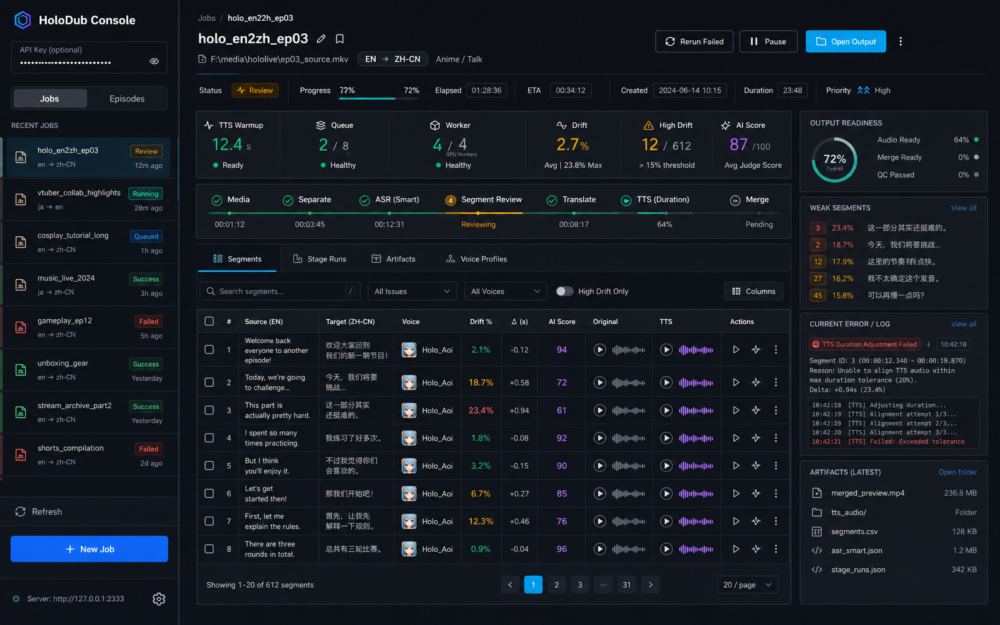
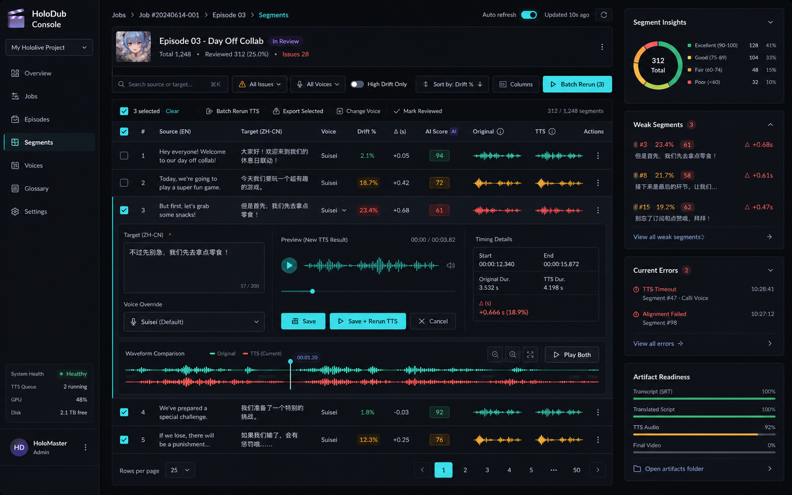
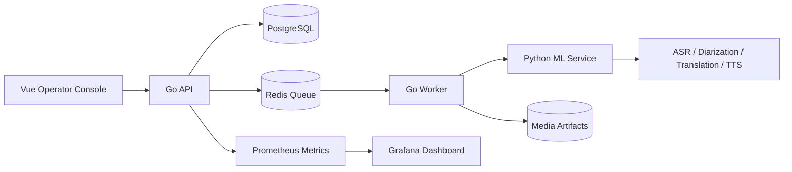

# HoloDub Documentation Map

HoloDub is more than a demo pipeline. It is a local-first dubbing studio with a Go control plane, Python ML workers, a Vue operator console, and observability assets for long-running media jobs. This page is the map for understanding, running, operating, and extending the system.

## Start Here

| Reader                       | Best Entry Point                                                   | What You Get                                                               |
| ---------------------------- | ------------------------------------------------------------------ | -------------------------------------------------------------------------- |
| New visitor                  | [Project README](../README.md) / [中文 README](../README_zh-CN.md) | Product story, screenshots, architecture, quick start, current status      |
| Backend or frontend engineer | [System overview](system-overview.md)                              | Service boundaries, runtime responsibilities, data flow                    |
| Console user                 | [UI usage guide](ui-guide.md)                                      | Create jobs, review segmentation, fix drift, manage voices, inspect output |
| Local operator               | [Configuration reference](configuration.md)                        | Environment modes, real ML settings, IndexTTS2, review, judge flags        |
| API integrator               | [OpenAPI spec](openapi.yaml)                                       | Jobs, segments, review, metrics, and operational endpoints                 |
| Operator                     | [Observability guide](observability/README.md)                     | Prometheus scrape config, alert rules, Grafana dashboard                   |
| Release owner                | [Production release runbook](production/release-runbook.md)        | Release checks, deployment path, rollback notes                            |
| ML quality owner             | [OPT-405 benchmark guide](opt-405/bench-README.md)                 | Chapter quality benchmark workflow and judge artifacts                     |
| ML quality owner             | [LoRA adapter training SOP](lora-adapter-training-sop.md)          | Adapter/voice asset model, training gates, promotion, rollback             |
| Course operator              | [MIT 6.824 dub production plan](mit6824-dub-production-plan.md)    | Lecture 8-20 delivery loop, acceptance artifacts, and training stop rules   |

## Visual Direction

The redesigned UI is organized around an operator-first idea: every job should reveal its state, risk, timing drift, and segment quality without forcing the user to read logs first.

These images are design references for the current console direction. The implementation keeps the same priorities: live pipeline visibility, filterable segments, waveform review, drift-aware quality signals, and fast retry controls.

For day-to-day usage, see the [UI usage guide](ui-guide.md).

## Running And Deploying

- [Configuration reference](configuration.md): readable guide to `.env.example`, real backend modes, IndexTTS2, review, chapterization, judge, and rework flags.
- [UI usage guide](ui-guide.md): console walkthrough for creating jobs, reviewing ASR segments, repairing drift, managing voices, and checking outputs.
- [Production release runbook](production/release-runbook.md): release checklist, validation sequence, deployment command path, and rollback.
- [Real backend rollout](production/real-backend-rollout.md): staged migration from smoke/demo mode into real ASR, translation, TTS, and merge execution.
- [Scale roadmap](production/scale-roadmap.md): practical scaling notes for workers, queues, GPU capacity, and storage pressure.
- [Chapter 2 drift rerun playbook](chapter2-drift-fix/pr3-rerun-playbook.md): targeted rerun procedure for timing drift repair.

## Observability

- [Observability README](observability/README.md): what to monitor and how to wire the local stack.
- [Prometheus scrape config](observability/prometheus-scrape.yaml): scrape targets for HoloDub services.
- [Prometheus alert rules](observability/prometheus-rules.yaml): first-line alerts for job failures, queue pressure, and worker health.
- [Grafana dashboard](observability/grafana-dashboard.json): importable dashboard for job throughput, latency, and failure diagnosis.

## Quality And Benchmarks

- [OPT-405 benchmark guide](opt-405/bench-README.md): reproducible chapter generation and evaluation workflow.
- [LoRA adapter training SOP](lora-adapter-training-sop.md): fixed contract for LoRA data tiers, validation gates, UI registry, promotion, and rollback.
- [MIT 6.824 dub production plan](mit6824-dub-production-plan.md): course-level delivery loop and training decision rule for finishing lectures 8-20.
- [OPT-405 baseline report](opt-405/bench-baseline-2026-05-11/report.md): model comparison and judged baseline results.
- [OPT-403 validation matrix](opt-403/validation-matrix.md): validation coverage for timing and processing behavior.
- [PR14 regression baselines](quality-mainline-q/pr14-regression-baselines.md): regression snapshots for the main quality path.

## Optimization History

- [Optimization roadmap](roadmap/optimization-roadmap.md): the main technical roadmap.
- [OPT-201 rollout](opt-201/rollout.md): first optimization rollout notes.
- [OPT-202 rollout](opt-202/rollout.md): follow-up rollout plan and validation.
- [OPT-204 rollout](opt-204/rollout.md): additional optimization release notes.
- [OPT-403 artifacts](opt-403/): baseline and dry-run artifacts for timing-related improvements.
- [OPT-405 artifacts](opt-405/): benchmark inputs, raw model outputs, judge outputs, and reports.

## How The Pieces Fit

## Documentation Style

The docs should stay practical and source-backed:

- Prefer runnable commands over prose-only instructions.
- Link to concrete configs, reports, and artifacts.
- Keep operator docs focused on failure recovery, timing drift, GPU pressure, and repeatability.
- When adding a new feature area, add a short entry here so the documentation surface stays discoverable.
