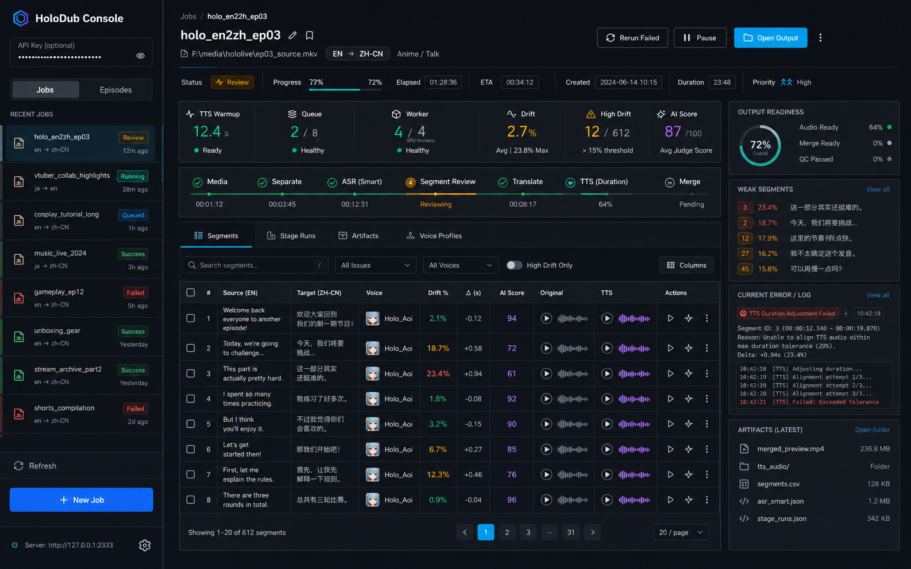
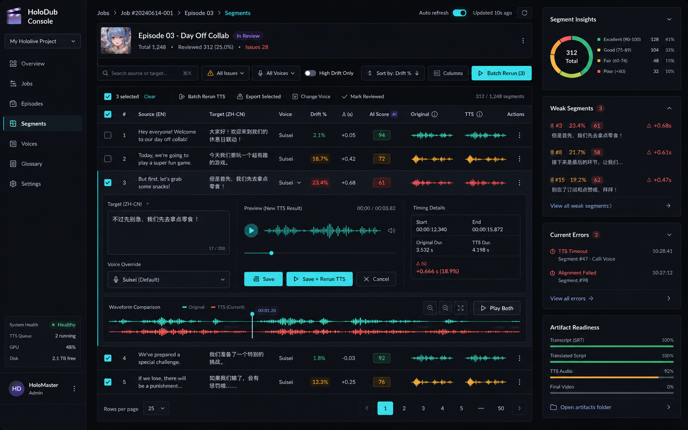

# HoloDub UI 使用指南

HoloDub Console 是给长视频配音任务使用的操作台。它的重点不是“看起来有进度条”，而是让操作员能快速判断：任务跑到哪一步、哪几段有风险、该重跑哪一段、最终输出是否已经可交付。

打开地址：

```text
http://localhost:8080/ui/
```

本地 smoke 模式通常不需要 API Key；如果后端设置了 `API_AUTH_TOKEN`，在左侧栏顶部的 **API Key** 输入框填入同一个 token。

左侧栏顶部提供 **中文 / English** 切换。选择会保存到浏览器本地存储，下次打开控制台会沿用上一次语言；切换时页面文案会即时更新，不需要刷新任务。

## 总览



上图是当前 UI 方向的概念图。实际实现遵循同一套信息结构：左侧任务导航，中间任务工作台，右侧风险与产物摘要。

| 区域         | 用途                                                                                  |
| ------------ | ------------------------------------------------------------------------------------- |
| 左侧导航     | 在 Jobs / Episodes 之间切换，查看 Running、Ready、Issues 摘要。                       |
| 语言切换     | 在中文和英文界面之间切换，并自动记住本机偏好。                                        |
| 新建任务     | 提交视频相对路径、源语言、目标语言，并选择是否创建后自动启动。                        |
| 任务头部     | 查看状态、当前阶段、语言、输入文件、开始/取消/重试合并/刷新等操作。                   |
| 阶段时间线   | 看到 `media -> separate -> asr_smart -> review -> translate -> TTS -> merge` 的进度。 |
| 段落工作台   | 审查译文、漂移、音色、AI 评分、原声/TTS、波形和单段操作。                             |
| 右侧观测面板 | 查看输出就绪度、高漂移弱段、当前错误和最近产物。                                      |

## 1. 创建和进入任务

在左下角点击 **新建任务**：

1. 填写任务名称，例如 `mit-lecture-zh`。
2. 填写 `input_relpath`，这是相对 `DATA_ROOT` 的路径，例如 `input.mp4` 或 `episodes/source/lecture.mp4`。
3. 设置源语言和目标语言，例如 `en` -> `zh-CN`。
4. 勾选 **创建后自动开始流水线**，任务会直接进入队列。

创建后，左侧 **Jobs** 列表会出现新任务。点击任务卡片进入详情页。

如果任务属于长视频 Episode，可以切到 **Episodes** 标签查看整集和章节状态。

## 2. 判断任务状态

进入 Job 详情后，先看顶部三处：

- **状态徽章**：`pending`、`queued`、`running`、`awaiting_review`、`completed`、`failed` 等。
- **指标卡片**：段落数、高漂移数、输出就绪度、AI 评分、运行时长等摘要。
- **Stage Timeline**：每个阶段都有进度和状态，失败点通常会在这里先暴露。

常用按钮：

| 按钮         | 使用场景                                                          |
| ------------ | ----------------------------------------------------------------- |
| 开始         | `pending` 任务尚未自动启动时。                                    |
| 取消任务     | 任务仍在 `pending`、`queued`、`running` 或 `awaiting_review` 时。 |
| 重新合并输出 | 已经修过段落或音频后，只想重新生成最终输出。                      |
| 刷新         | 立即拉取最新任务、段落、阶段记录、产物和音色信息。                |

如果顶部出现 **TTS 模型预热中** 提示，说明 IndexTTS2 正在后台加载。此时可以继续查看任务，但首次真实 TTS 需要等模型进入 ready 状态。

## 3. 分段审核

当任务处于 `awaiting_review` 时，详情页会出现 **分段审核** 标签。这个阶段发生在翻译前，适合修 ASR 边界和原文识别错误，避免把错误一路带到 TTS。

### AI 分段建议

顶部的 **AI 分段建议** 会列出可疑片段：

- **采纳**：应用建议，例如合并两个被错误切开的短句。
- **否决**：保留原切分。
- **置信度**：越高越适合直接采纳；低置信建议建议人工听一下。

### 手动修分段

分段表格支持这些操作：

| 操作          | 说明                                                               |
| ------------- | ------------------------------------------------------------------ |
| 原声          | 播放当前段的原始音频切片。                                         |
| 合并↓         | 与下一段合并，适合一句话被切成两段的情况。                         |
| 拆分          | 在原文中选择拆分字符位置，后端按比例拆分时间范围。                 |
| 调整时间      | 修改起止秒数，并可先试听调整后的片段窗口。                         |
| 编辑原文      | 直接修正 ASR 文本，不改变时间轴。                                  |
| 重新识别      | 只对当前段重新跑 ASR，不清空其他段落。                             |
| 重试 ASR 分段 | 清空当前分段和建议，重新执行整段 `asr_smart`，这是更大的重置操作。 |

确认无明显问题后，点击 **确认分段，开始翻译**。任务会进入 `translate`。

## 4. 段落精修工作台



段落工作台是 HoloDub 最重要的日常界面。翻译和 TTS 完成后，大多数质量问题都可以在这里定位并修复。

### 筛选和排序

表格上方的筛选器支持：

| 控件       | 用途                                  |
| ---------- | ------------------------------------- |
| 全部       | 查看所有段落。                        |
| 高漂移     | 只看 TTS 时长与原时长偏差较大的段落。 |
| 未合成     | 找出还没有 TTS 音频的段落。           |
| 序号排序   | 按原始时间顺序审查。                  |
| 漂移率排序 | 优先处理最严重的同步问题。            |

快捷键：

| 快捷键  | 动作                     |
| ------- | ------------------------ |
| `J`     | 下一段。                 |
| `K`     | 上一段。                 |
| `Space` | 播放或暂停当前段的 TTS。 |
| `E`     | 打开或收起当前段编辑器。 |

### 阅读段落表格

核心列的含义：

| 列          | 说明                                                                     |
| ----------- | ------------------------------------------------------------------------ |
| 原文 / 译文 | ASR 文本和译文。译文可在行内编辑。                                       |
| 声音        | 当前说话人绑定的 Voice Profile；可直接修改绑定。                         |
| 漂移率      | TTS 时长与原始时长的相对偏差，绿色较安全，红色需要优先处理。             |
| 偏差时长    | 有符号秒数；正数表示 TTS 太长，负数表示 TTS 太短。                       |
| AI 评分     | 如果启用了 judge，显示段落级质量评分，悬停可看 fidelity/fluency 等细节。 |
| 原声 / TTS  | 点击播放按钮后加载音频，支持对听。                                       |
| 操作        | 编辑、重新合成、展开波形。                                               |

右侧 **Weak Segments** 会自动列出高漂移段落，适合从最危险的段落开始修。

### 编辑译文并重合成

点击某行的 **编辑**：

1. 修改译文。
2. 可选择此段专用的音色覆盖。
3. 点击 **试听** 可以先生成预览音频。
4. 点击 **仅保存** 只保存文本。
5. 点击 **保存 + 重新合成** 会保存文本并对该段重跑 TTS。

如果你只是改了标点或术语，建议先试听；如果漂移已经很高，直接 **保存 + 重新合成** 更省时间。

### 单段和批量重合成

- 单段：点击行内循环箭头按钮，只重跑当前段 TTS。
- 批量：勾选多个已合成段落后，顶部会出现 **批量重合成**。
- 全量：在音色配置区使用 **清除已有音频并重新合成全部**，适合换了默认音色或整体语速策略后使用。

重合成后，旧音频缓存会失效；刷新或重新点击播放按钮即可加载新音频。

### 原声 / TTS 对听和波形

点击行内 **原声** 或 **TTS** 的播放按钮，会按需加载音频。点击 **波形** 可展开双波形视图：

- 左侧是原声片段。
- 右侧是合成 TTS。
- 对比两者的长度、停顿、尾音和能量形状，可以判断是译文太长、语速不合适，还是切分边界有问题。

处理建议：

| 现象                | 推荐动作                                   |
| ------------------- | ------------------------------------------ |
| TTS 明显太长        | 压缩译文，或让重翻译模型重新生成更短版本。 |
| TTS 明显太短        | 补足语义，避免画面中出现过长空白。         |
| 原声开头/结尾被截断 | 回到分段审核调整时间，或对该段重新识别。   |
| 音色不对            | 修改说话人绑定或单段音色覆盖，然后重合成。 |

## 5. 音色管理

进入 **音色管理** 标签可以维护 Voice Profiles。常见模式：

- `sample`：使用一段或多段参考音频做零样本声纹克隆。
- `checkpoint`：使用自定义模型 checkpoint。

在 **段落** 标签中也可以处理音色：

1. 在顶部 **音色配置** 中选择目标音色，并应用到全部段落。
2. 在单行 **声音** 列修改某个说话人的绑定。
3. 在行内编辑器中为单个段落设置音色覆盖。

注意：修改绑定不会自动开始 TTS。需要手动单段重合成、批量重合成，或清除并重合成全部。

## 6. 阶段记录、输出文件和右侧面板

详情页的其他标签和侧栏用于排障：

| 位置                | 用途                                             |
| ------------------- | ------------------------------------------------ |
| 阶段记录            | 查看每个 stage 的状态、attempt、耗时和错误。     |
| 输出文件            | 查看当前 Job 产生的 artifact 路径和大小。        |
| Output Readiness    | 看 TTS 音频完成比例、artifact 数量、高漂移数量。 |
| Current Error / Log | 查看任务级错误；没有错误时会显示绿色状态。       |
| Artifacts 摘要      | 快速看到最近几个输出文件。                       |

如果最终视频没有更新，但段落已经修好，先点击 **重新合并输出**，再查看输出文件。

## 7. 推荐工作流

### 快速烟测

1. 用默认 `.env.example` 配置启动。
2. 创建一个短视频任务，保持自动启动。
3. 看 Jobs 列表是否出现任务。
4. 进入详情页确认阶段时间线推进。
5. 查看输出文件是否产生占位结果。

### 真实配音任务

1. 在 [配置参考](configuration.md) 中启用真实 ASR、翻译和 IndexTTS2。
2. 创建任务并自动启动。
3. 如果进入 `awaiting_review`，先处理分段审核。
4. 翻译和 TTS 完成后，切到 **高漂移**，按漂移率从高到低处理。
5. 对关键段落进行原声/TTS 对听和波形检查。
6. 修译文、调音色、重合成。
7. 点击 **重新合并输出**。
8. 在输出文件中确认最终 artifact。

### 长视频 Episode

1. 在左侧切到 **Episodes**。
2. 进入 Episode 详情查看章节数、整集状态和章节输出。
3. 如果某个章节失败，进入对应 Job 只修该章节。
4. 所有章节完成后，等待 episode merge 产生整集输出。

## 8. 常见问题

| 现象                | 处理方式                                                                                       |
| ------------------- | ---------------------------------------------------------------------------------------------- |
| 左侧显示 API 未连接 | 如果正在用 Vite 预览前端，这是正常提示；连接 Go API 的 `/ui/` 后会显示真实任务。               |
| API 请求 401/403    | 检查左侧 API Key 是否与 `API_AUTH_TOKEN` 一致。                                                |
| TTS 一直很慢        | 看顶部是否仍在模型预热；同时查看 [可观测性配置](observability/README.md) 中的 ML warmup 指标。 |
| 高漂移很多          | 先按漂移率排序，优先修红色段；通常从压缩译文、换音色、重合成开始。                             |
| 没有 TTS 音频       | 切到 **未合成**，确认段落状态；必要时对 `tts_duration` 阶段重试。                              |
| 最终视频不是最新    | 修改段落后需要重新合并输出。                                                                   |

## 9. 和监控面板一起使用

UI 适合处理单个任务和段落；Prometheus/Grafana 适合看整体服务健康。

建议搭配：

- UI：看 Job 状态、弱段、音频、波形、人工修复。
- [Grafana dashboard](observability/grafana-dashboard.json)：看吞吐、延迟、失败率、GPU 等待和模型预热。
- [阶段记录](#6-阶段记录输出文件和右侧面板)：定位单个任务在哪个 stage 失败。
- Worker / ML 日志：定位具体异常栈和模型错误。

## 10. 设计图和实际界面的关系

这份指南使用的两张图是 UI 概念图，不要求每个像素与当前 Vue 实现一致。它们用于说明 HoloDub Console 的产品方向：

- 第一张强调 **任务级可观测性**：状态、阶段、风险、产物和错误都要能被看见。
- 第二张强调 **段落级精修**：漂移、音色、波形、重合成和人工判断必须放在同一个工作流里。

当前实现已经覆盖这些核心工作流，后续 UI 迭代应继续围绕“减少黑盒感、缩短定位时间、降低整片重跑成本”推进。
